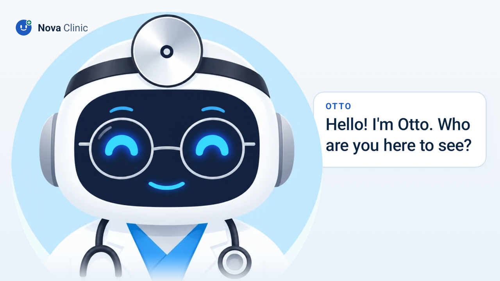
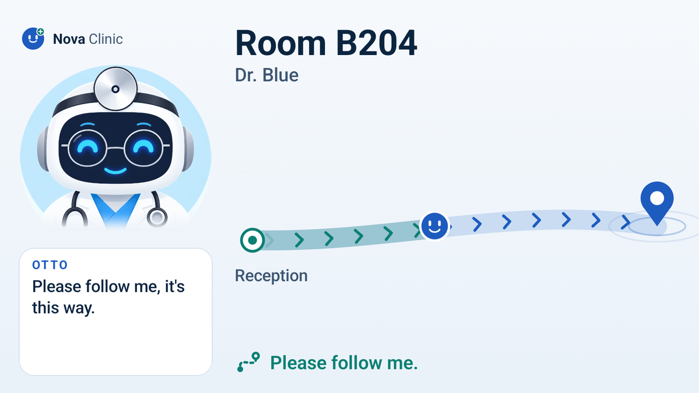
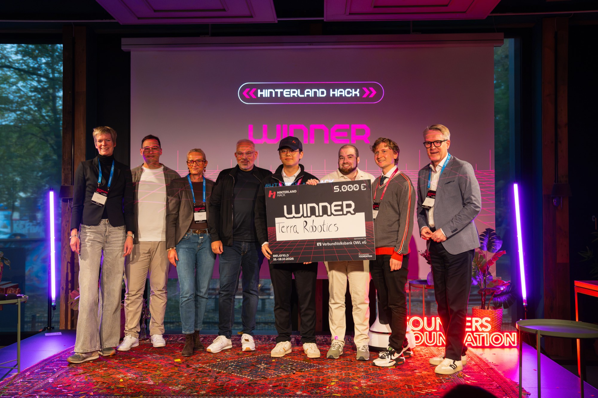

# Otto

Our solution for the Terra Robotics challenge at Hinterland of Things 2026. Otto is a clinic guide on an OrionStar Nova robot. The patient talks to him, he checks them in with an anonymous ticket, the doctor gets a message, and Otto walks the patient to the room at their pace.

### Challenge

Patients get lost in hospitals, and the people they ask are the nurses and doctors who then walk them there. A sign does not help much if you walk slowly, feel nervous, or don't speak the language. Otto walks with the patient instead of ahead of them. Staff stay in charge of where the patient goes. Otto only knows a ticket, such as A17, and the room.

### On the robot

Most of the time the face fills the screen. When something happens, the face moves aside and the task shows next to it.

#### Greeting

<br>
Otto greets a patient. What he says shows in a speech bubble next to his face.

#### Walking

<br>
On the way to Room B204: the route from A to B, Otto on it, arrows towards the pin.

#### Arrived

<br>
Arrived with a patient.

#### Afterwards

<br>
After a thumbs up from the patient.

### Terra Robotics winner

<br>
Winner of the Terra Robotics challenge. Photo: 29ZEHN.

### Try it without a robot

The reception board runs on a laptop. Virtual Otto walks the same loop on the map, with no robot and no accounts.

```bash
cd team-inbox
npm install
cp .env.example .env.local
npm run dev
```

Open http://localhost:3000. Under Settings, Places add a reception, an exit and a room. Open http://localhost:3000/simulate and press "Play the whole demo". On the reception, switch the live card to Virtual Otto.

`npm run dev` recompiles as you edit. `npm run serve:lan` builds once and serves on the local network, which is what the robot talks to. Details, pages and environment variables are in `team-inbox/README.md`.

### How it is built

Otto is two programs that share one ticket. `robot-app/` is Kotlin and Jetpack Compose on OrionStar AgentOS. The screen is Otto's face. The conversation goes through the robot's own language model, which calls a small set of actions: check in, set the pace, wait, ask where we are. Walking uses the robot's navigation. A patient is a ticket. The app stores no name and no reason for the visit. On the way Otto uses the pace the desk chose, stops and turns to check that someone is still beside him, and uses the lidar only to tell a person-sized shape from a wall. He does not recognise faces and he does not keep images. If the person falls behind he waits, then asks the desk for help. A rehearsed demo mode turns the microphone off and speaks a fixed script, while the driving, the ticket and the dashboard stay real.

`team-inbox/` is a Next.js reception board. Staff pick a room and a pace, or the patient checks in on Otto. The board creates the journey, sends the ticket to the doctor over Teams, Slack, Telegram or the other channels, and shows the live map, the floor plan Otto uploads, and what Otto is doing. The robot polls the board for the next leg and reports every step back. Speed, voice and sensors are edited in the browser and applied on the robot without a new build. With no database the board keeps the day in memory. `/simulate` runs Virtual Otto on that same map.

### In this repo

- `robot-app/` - the Android app on the robot (Kotlin, Jetpack Compose, AgentOS SDK 0.4.5). On the robot's home screen the app is still called Nova Clinic.
- `team-inbox/` - the reception board.
- `docs/` - the contracts: journeys, the API, demo mode, the robot setup, deploy.
- `resources/presentation/Otto.pdf` - the pitch.

The robot setup, the signing keys and the laptop address stay out of git. `docs/deploy.md` is the deploy path. `docs/robot-setup.md` is the map, the floors and the live settings.

### Presentation

[Otto.pdf](resources/presentation/Otto.pdf)
