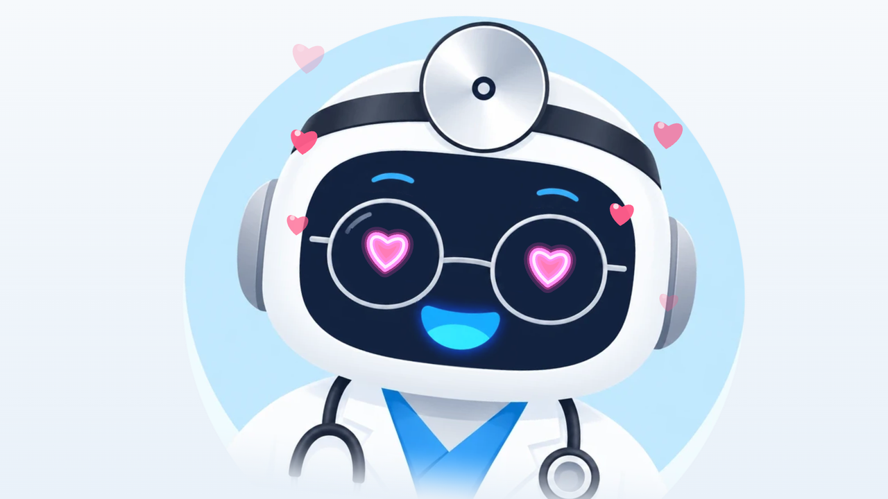

# Hinterland Hack - Nova Clinic

Our entry for the Terra Robotics Challenge (Smart Receptionist). The robot (OrionStar Nova on AgentOS) does the reception of a doctor's practice: the patient just talks to it, Otto checks them in, the doctor gets a Teams card, and when the doctor is ready Otto walks the patient to the room and drives back.

## Meet Otto

| | |
|---|---|
|  |  |
| Otto greets a patient. What he says shows in a speech bubble next to his face. | On the way to Room B204: the route from A to B, Otto on it, arrows towards the pin. |
|  |  |
| Arrived with a patient. | After a thumbs up from the patient. |

Most of the time the face fills the screen. When something happens (a walk, a check-in step, help), the face moves to the side and the info shows next to it.

## What's in here

- `robot-app/` - Android app for the robot (Kotlin, Jetpack Compose, AgentOS SDK 0.4.5). "Nova Clinic": Otto picks a patient up by ticket, walks with them at their pace to the room the team chose, checks they still follow, and brings them to the exit. See [Robot app](#robot-app).
- `team-inbox/` - Next.js. The reception board: visits per doctor, Teams cards with a "Call patient in" button, doctor list, and `/simulate` to demo the loop without the robot. See `team-inbox/README.md`.

## How it works

The API between the two parts is in `docs/api.md`.

1. The patient talks to Otto. The AgentOS LLM asks for name, doctor and appointment time, reads them back once and then picks `CHECK_IN`.
2. The app POSTs the visit to `team-inbox`, the doctor gets a Teams card, Otto says the reply and the screen shows the steps.
3. The doctor taps "Call patient in". The app picks this up from `/api/robot/next`.
4. Otto calls the patient, walks to the doctor's room, says goodbye and drives back to reception. Each step is PATCHed to the visit, so the dashboard follows along.

## Setup on this laptop (done 16.10.2026)

- Android Studio, Android SDK in `%LOCALAPPDATA%\Android\Sdk`, `adb` in its `platform-tools` (on PATH)
- `robot-app/local.properties` (not in git): `sdk.dir`, `teamInbox.url` (base url, no path), `teamInbox.token`, `robot.name`, `robot.homeSpot`
- `team-inbox/.env.local` (not in git): `TEAM_INBOX_TOKEN` (same token as above), `CALL_KEY`, `IOT_KEY`, `TEAMS_WEBHOOK_URL` (empty for now). All options are in `team-inbox/.env.example`

## Still open before it runs on the robot

1. **appId** - done. Agent "Team Relay" in the portal (Agent App Development), id is in `robot-app/app/src/main/assets/actionRegistry.json`.
2. **ROM version** - done. Our Otto (model OS-R-SG04, SN M03SHW2A30025032951B) is on OrionStar OS 12.1, so the app uses SDK 0.4.5-SNAPSHOT (newest one for V11.7 up to before 12.3). If the robot gets updated to 12.6, switch to 0.4.12-SNAPSHOT in `robot-app/app/build.gradle.kts`.
3. **Developer mode** - ADB is off by default. Swipe down, tap the time area many times, enter the temporary password from OrionStar support (send them the SN above). Turn on debug and persistent debug, reboot.
4. **Connect** - `adb connect <robot-ip>:5555` (same Wi-Fi) or micro-USB cable at the head.

## Run

Team inbox:

```
cd team-inbox
npm run dev:lan
```

The dashboard is on http://localhost:3000, and the robot talks to `http://<laptop-ip>:3000/api/...` (see `docs/api.md`). The first time, Windows Firewall asks about node, so allow it for private networks or the robot can't reach it.

Robot app: open `robot-app` in Android Studio, pick the robot as the device and press Run. Or from a terminal:

```
cd robot-app
gradlew.bat assembleDebug
adb connect <robot-ip>:5555
adb install -r app\build\outputs\apk\debug\app-debug.apk
```

Then start "Nova Clinic" from the robot's home screen. OrionStar says to start apps through RobotOS Home, otherwise the app may not get the rights to drive.

## Robot app

`robot-app/` is "Nova Clinic" v3, the robot side of `docs/journeys.md` (section 4 and 5). The team decides where a patient goes, Otto walks with them. Otto only knows a ticket (`A17`) and the room: no names, no reasons for the visit, nothing recorded.

A `guide` command from `/api/robot/next` runs like this (`Guide.kt`):

1. Pickup: Otto drives to the pickup spot if he isn't there, shows the ticket very large with a "That's me" button and calls the ticket (in the languages from `robot.callLanguages`, default `de,en`). Reminder every 45 s, after 3 min the leg is `failed` ("Nobody came") and he goes back.
2. Pace: if staff didn't set slow or very slow, he asks "normally or a bit slower?". Speeds are in `Pace.kt` (0.6 / 0.4 / 0.25 m/s, wheelchair = slow), all inside what RobotApi navigation accepts.
3. Walking: navigation at that speed. About every 25 s of driving, and right after waiting for an obstacle, he stops, turns around and looks for a person: close (3 m) -> "all good, shall I slow down?"; 3-6 m -> waits up to 20 s and slows down one step; nobody -> calls twice, after 30 s `lost_patient` + a help request to the team, after 60 s more the leg fails. He also talks at half way and almost there (from the robot's position on the map).
4. Arrival: "This is Room B204, please take a seat", or goodbye at the exit, then an optional thumbs up / down. Then back to reception (the `reception` place from `/api/places`, else `robot.homeSpot`), or straight to the next leg.

Every step is PATCHed to the journey (leg status + event, ticket only). While he walks, fetches or drives back, Nova Deploy gets the busy hold. During a guide the mic does not wait for a face (the patient walks behind), barge-in stays on.

Actions (in `ClinicActions.kt`, the LLM picks them by their description):

- `CONFIRM_TICKET` `ticket` - the person says the ticket Otto calls.
- `SET_PACE` `pace` (normal / slow / very_slow) - slower, faster, or go on after a pause.
- `PAUSE_WALK` - wait right here.
- `WALK_STATUS` - how far, how long, where are we.
- `GUIDE_TO_PLACE` `place` - only places that are public (plus exit and reception). For rooms Otto says the reception desk assigns them.
- `CHECK_IN_FOR` `place` - self check-in by voice for a room marked `selfCheckIn`.
- `WAITING_STATUS` `ticket` - where that ticket stands, place in line, about how long.
- `CALL_STAFF` `summary`, `urgency` - no health details; urgent also tells the person to call 112 and Otto stays.

Self check-in on the screen: "Check in" on the welcome screen, then who (the `selfCheckIn` rooms as tiles, or "I'm not sure"), how to walk, confirm. That POSTs `/api/journeys` and Otto walks the visitor to the room's waiting place.

The team can also send `say` (said as it is), `go_to` (drive there and stay) and `ask` (goes to AgentOS like something a person said, so Otto's AI decides). Everything Otto says on his own is written by the AgentOS LLM from a short English instruction in the patient's language, so there are no language or place lists in the code.

Otto still acts on his own (`OttoBrain.kt`, the priorities are in `Brain.kt`): urgent help first, then what the person in front asked for, then the team's commands, greeting someone who walks up, charging at 20 %, going back to reception.

Heartbeat every 15 s (and right away when the screen changes) with a `screen` mirror for the dashboard. Otto's lines go to `/api/robot/feed`; from the patient only what Otto understood ("asked to walk slower"), their own words only when the dashboard's demo switch is on.

The screen (549x308 dp, laid out at 1280x720 and scaled): Otto's face and what was just said on the left, the task on the right in large type. Motion is gentle and stops when Android's "remove animations" is on. The app has its own adaptive icon (Otto's face, blue to teal).

Map: every place needs a spot on the robot map with the `spot` name from the dashboard. The robot has to be localized on that map.

Tests for the plain logic (walk planner, pace table, pickup and lost-patient timelines, places, JSON, Otto's priorities, the screen mirror, the feed): `gradlew.bat :app:testDebugUnitTest`.

## Deploy to the robot

Nova Clinic is deployed by Nova Deploy (separate repo `nova-deploy`): push to `main`, GitHub runs the unit tests and builds the APK signed with our robot key, and Nova Deploy on the robot installs it. Redeploy and rollback are on the Nova Deploy dashboard. What this repo has for it (`nova-deploy.json`, the workflow, signing, the secrets, the busy hold) is in `docs/deploy.md`.

- Nova Deploy never replaces Nova Clinic while he walks, fetches a patient or drives back: the app sends it a busy hold.
- Without ADB, Android 9 asks for one tap on "Install" per update. Nova Deploy's optional auto-tap helper presses it.
- After an update the robot's home screen comes to the front. Start Nova Clinic from there, otherwise it can't drive.

One-time setup on the robot: uninstall the old Nova Clinic once (it was signed with the laptop's key), install Nova Deploy from a link in Chrome, allow installs for it and open it once.

## Notes

- The laptop IP changes at the venue. Update `teamInbox.url` in `local.properties` (just `http://<ip>:3000`) and rebuild.
- Without `DATABASE_URL` everything lives in memory, so a restart wipes it. With a Neon url, run `npm run db:setup` once.
- The dashboard has no login unless `DASHBOARD_PASSWORD` is set. Fine on the local network, set it before a public deploy.
- On AgentOS the old RobotAPI voice stuff (ASR/TTS/NLP) is off. Everything voice goes through the AgentOS SDK.

## Links

- AgentOS SDK docs: https://github.com/orionagent/agentos-sdk
- Official sample: https://github.com/orionagent/AgentSDKSample
- Old RobotOS jars: https://github.com/OrionStarGIT/RobotSample/releases
- Cloud OpenAPI: https://openapi.orionstar.com/opendocs/zh/index
- Robot portal: https://global-robotmp.orionstar.com
